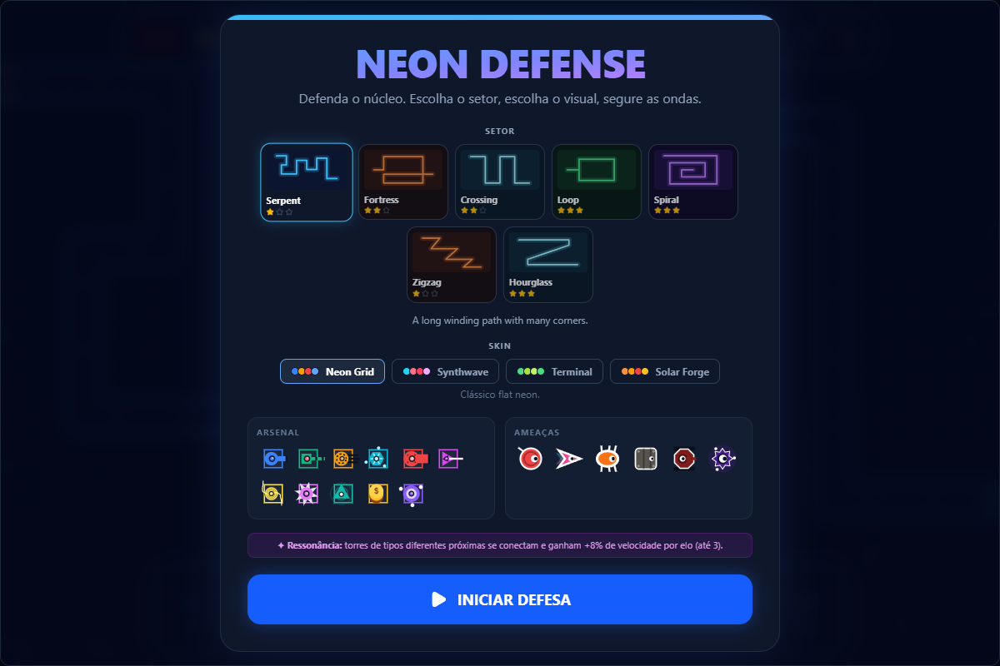
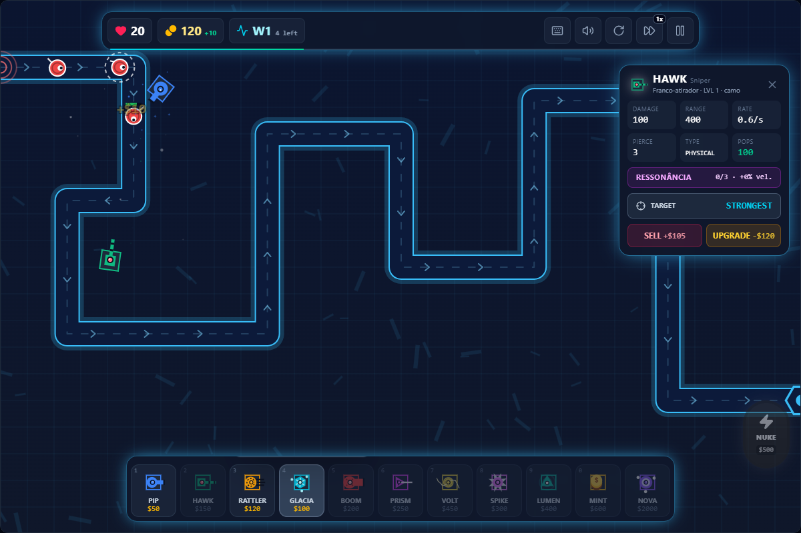
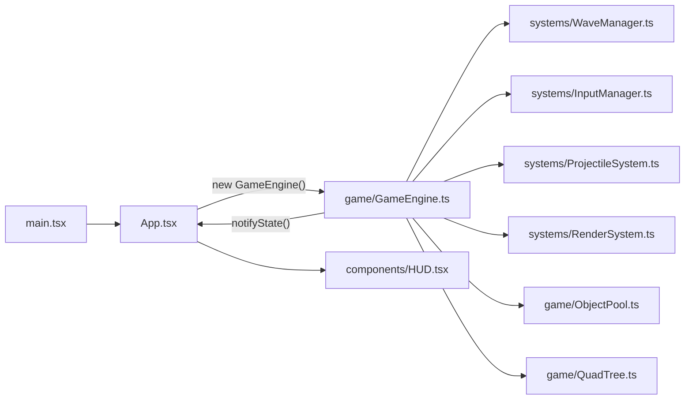

<div align="center">

# 🗼 Neon Defense (Tower Defense)

[](https://reactjs.org/)
[](https://vitejs.dev/)
[](https://tailwindcss.com/)
[](https://www.typescriptlang.org/)

**A modern, high-performance Tower Defense game built with React 19, HTML5 Canvas, and a stunning "Flat Neon" aesthetic.**

<br/>



</div>

## ✨ Features

- **Neon Engine**: Custom high-frequency Canvas rendering engine for 60FPS performance with visual feedback like pulsating range rings.
- **Themed Sectors & Skins**: 7 maps with unique biomes (Grid, Foundry, Cryo, Reactor, Void), animated spawn portal/core, and 4 selectable unit skins.
- **Resonance Grid**: towers of different types placed close together link up (glowing lines) and gain +8% attack speed per link (max 3); placement preview shows the links you'd create.
- **Characters**: every tower and enemy has a procedural animated sprite, a callsign and role (`Lore.ts`); UI previews reuse the same sprite code.
- **Roguelite Mods**: Dynamic upgrade system offered every 5 waves for deep strategic variety.
- **Deep Tower Upgrades**: 11 tower types with branching Level 3 upgrades (Path A or Path B).
- **Complex Mechanics**: Damage types (Physical, Energy, Cold), Resistances, Pierce, and Status Effects (SLOW, BURN, STUN).
- **Procedural Audio**: Dynamic sound effects generated via Web Audio API.

## 🎮 Tour

| | |
|---|---|
|  | **Setup**<br/>Pick one of 7 sectors, one of 4 skins, and review the arsenal and threats before the round. |
|  | **In-game**<br/>Lives, money and wave counter at the top; the selected tower panel offers target mode, sell and upgrade; the bottom bar places towers and calls the nuke. |

## 🧭 How It Works



The React shell owns the HUD and menus; `GameEngine.ts` owns the canvas loop. Each frame it hands projectiles to `ObjectPool.ts` instead of allocating, and `QuadTree.ts` narrows target lookups. `notifyState()` is the only path that pushes money, lives and wave changes into the HUD.

## 🛠️ Tech Stack

- **Game Logic**: HTML5 Canvas + TypeScript
- **Framework**: React 19 (for HUD/UI)
- **Styling**: TailwindCSS 4.x
- **Build**: Vite 8.x (with PWA Support)

## 🚀 Play Now

```bash
# Install dependencies
pnpm install

# Start development server (http://localhost:5173)
pnpm run dev

# Build for production
pnpm run build

# Lint the source (see Known Limitations)
pnpm run lint
```

> [!WARNING]
> On `master`, `pnpm run build` and `pnpm run lint` exit with an error: an unused `useState` import in `src/components/HUD.tsx` fails both `tsc -b` and `eslint .`.

## 🛡️ Antigravity Protocol

This project follows the **Antigravity** code standards:
- **Object Pooling**: Mandatory for projectiles and particles to ensure performance.
- **180-Line Target**: Large files should be split into specialized modules (e.g., `StatusEffects.ts`, `Maps.ts`). `GameEngine.ts` (921 lines) is still above this target.
- **Strict Typing**: Full typing for all game entities and engine states.
- **Neon Aesthetic**: Maintain flat visuals and vector-based rendering.

## 🚧 Known Limitations

- The build and lint scripts currently fail (see the warning above); the Vite dev server runs.
- No automated test suite is wired into `package.json`. `verification/` holds Python and Playwright scripts that are not run by any script.
- Two lockfiles are committed: `pnpm-lock.yaml` (used by the Dockerfile and `pnpm install --frozen-lockfile`) and `package-lock.json`.

---

*"Strategy is just another word for survival."*
